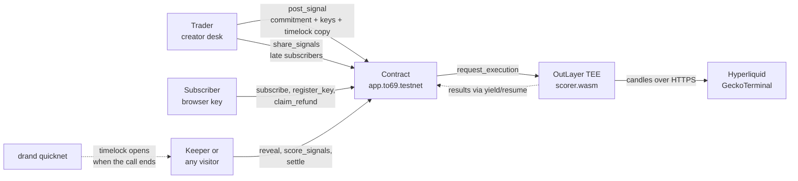
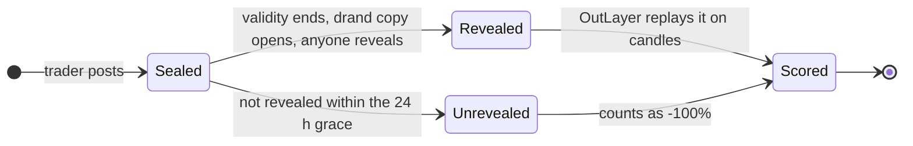
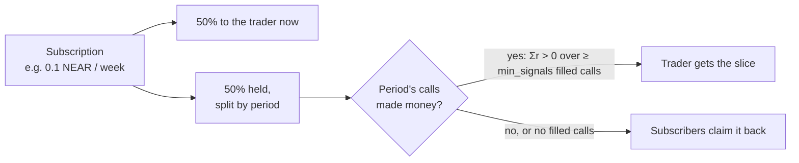

# Sealed Calls

**Paid trading calls that can't be deleted.** Every call is sealed on NEAR when it's posted, opens to everyone when it ends, and is scored on real market candles. The trader gets the second half of each subscription only for periods when their calls made money.

Built for NEAR HACKATHON 2026 by Towhid ([@0xTowhid](https://x.com/0xTowhid)). Testnet only.

| | |
| :--- | :--- |
| **Live app** | https://sealed-calls.vercel.app/ (mirror: https://0xtowhid.github.io/sealed-calls/) |
| **Contract** | [`app.to69.testnet`](https://testnet.nearblocks.io/address/app.to69.testnet) on NEAR testnet |
| **Scoring** | OutLayer job on `outlayer.testnet`; its wasm URL and sha256 are readable from `get_config` |
| **Tracks** | Open Innovation (`open`), Privacy & Private AI (`privacy`), Social Money (`social`) |
| **Other project** | [Pixel Bazaar](https://github.com/0xTowhid/pixel-bazaar), an independent game, submitted separately |

## The problem

Paid signal groups sell access to a trader's calls, but the trader controls the record:

- losing calls get deleted or edited,
- entries get "adjusted" after the fact,
- screenshots of winners are all a buyer can check,
- subscribers pay up front whether the calls work or not.

## What Sealed Calls does

| | |
| :--- | :--- |
| **A call can't be changed or hidden** | The contract stores a sha256 commitment of the call. Subscribers active at that moment decrypt it at once in their browser; a timelocked copy (drand) opens for everyone when the call ends. Anyone can reveal it, and the contract checks it against the commitment. |
| **Every call is scored the same way** | When a call ends, an OutLayer job replays it on public candles (Hyperliquid for perps, GeckoTerminal for DEX tokens): entry fill, take-profits, stop loss, leverage, liquidation, fees and price impact for a $500 trade. The result is written to the contract. |
| **Payment follows results** | 50% of a subscription goes to the trader at once. The other 50% is held and split over the periods it covers. Each period, the trader gets that slice only if their calls made money; otherwise subscribers claim it back. |

> **What we claim, and only this:** calls can't be edited, deleted or hidden, and become public when they end. Results are indicative replays on public candles, not executed trades. Sealed Calls doesn't stop a trader trading against subscribers or a subscriber leaking calls; it makes the record public and pays the trader in full only when calls work.

## Architecture



## The life of a call



While a call is **Sealed**, the public record shows a locked row with a countdown, and only subscribers (decrypting in their own browser) see the levels.

## Where the money goes



## Try it: live app (5 minutes, browser only)

You need a NEAR **testnet** wallet ([MyNearWallet](https://testnet.mynearwallet.com) or Meteor) with a little testnet NEAR from [near-faucet.io](https://near-faucet.io).

| # | Do | See |
| :-: | :--- | :--- |
| 1 | Open https://sealed-calls.vercel.app/ and scroll | The landing page: the envelope opens on the latest real scored call; the numbers are live from the contract |
| 2 | Click **Open app** (or open `/#/`) | **Explore**: totals from the contract and a leaderboard of traders |
| 3 | Click a trader | Their channel: score, result chart and **Every call** (ended calls with levels and result; live ones as **Sealed call** with a countdown) |
| 4 | Click **Connect wallet**, sign in | Your account and balance in the top bar |
| 5 | On a channel, pick a plan, click **Subscribe** | The wallet asks for the plan price (+0.05 NEAR storage, mostly refunded); then **Your subscription · active until …** |
| 6 | Open **Feed**, click **Set up this browser** (0.01 NEAR) | New calls from that channel appear decrypted here, with **✓ Same signal that's locked on-chain**, while the channel still shows them sealed |
| 7 | Open **Creator desk**, create a channel, then in **New signal** type `ETH`, pick the Hyperliquid market, fill side, leverage, buy range, TP1, SL, validity (e.g. 15 min), click **Seal and post** | A sealed row with a countdown on your channel; clear text in your subscribers' feeds. **Add 0.1 NEAR** under Late subscribers lets the desk share live calls with people who subscribe later |
| 8 | Wait for the validity to end | The call opens for everyone (**Reveal now**, or the keeper does it), shows an "est." result, then the official OutLayer result |

Without a wallet you can still do steps 1–3, and preview any account read-only with `?viewas=<account>.testnet` (e.g. `?viewas=to69.testnet#/feed`).

## Try it: from source (no keys needed)

**Prerequisites:** Rust (stable, tested with 1.97) and Node.js 20 or newer.

```bash
git clone https://github.com/0xTowhid/sealed-calls && cd sealed-calls

# 1. Contract: channels, plans, 50/50 escrow, sealing, reveal, late access, kinds, scoring callbacks, settlement, refunds
cd contract && cargo test && cd ..
# see: "test result: ok. 58 passed"

# 2. Scorer: fills, TP/SL on closes, leverage + liquidation on wicks, shorts, fees, DEX price impact, micro-cap rules
cd scorer && cargo test && cd ..
# see: "test result: ok. 15 passed"

# 3. Read the live contract on testnet
cd scripts && npm install
node sc.mjs view app.to69.testnet get_config '{}'
# see: JSON with period_minutes, scorer_wasm_url, scorer_wasm_hash, "outlayer":"outlayer.testnet", liquidity_floor_usd
node sc.mjs view app.to69.testnet list_channels '{}'
# see: the channels, each with creator, plans, signal_count and stats
cd ..

# 4. Run the web app locally against the live contract
cd web && npm install && npm run dev
# open the printed http://localhost:5173/ → the same Explore page as the live app
```

**Optional:** run the scoring job itself on live prices (needs the `wasm32-wasip2` target and [wasmtime](https://wasmtime.dev)):

```bash
rustup target add wasm32-wasip2
cd scorer && cargo build --release --target wasm32-wasip2 && cd ..
node scripts/sample-signals.mjs | wasmtime run -S http scorer/target/wasm32-wasip2/release/scorer.wasm
# see: {"ok":true,"results":[{"id":1,"r_bps":…,"outcome":…}, …, {"id":5,"r_bps":-10000,"outcome":"no_market"}]}
```

**Build the contract wasm:** `cd contract && cargo near build non-reproducible-wasm --no-embed-abi` (needs [cargo-near](https://github.com/near/cargo-near)).

## The full loop on testnet (evidence)

`scripts/testnet.sh e2e` runs the whole product against real testnet, real drand and real OutLayer on a throwaway contract with a 20-minute period, then deletes it:

1. `to69.testnet` creates a channel; `m1` subscribes and registers a browser key; `m2` subscribes without one → the subscribe events show the 50/50 split.
2. A BTC call is sealed and posted → `m1` decrypts it and the hash matches; an early timelock open is refused.
3. `m2` sets up a key only after the post → the creator shares the live call with them (`share_signals`) and they decrypt it; an early `reveal` is refused.
4. After validity → anyone opens the drand copy and reveals it → `score_signals` sends it to OutLayer and the official result is written back.
5. After the period → `settle` → the held half goes to the creator (positive score) or becomes claimable, and `m1` claims its refund.

It runs in GitHub Actions (`.github/workflows/testnet.yml`, signing with a testnet-only key stored as a repo secret). Logs are on the [`testnet-results`](https://github.com/0xTowhid/sealed-calls/tree/testnet-results) branch (one file per run, `<time>-e2e.txt`; the keeper overwrites `keeper-latest.txt`). To run it yourself with your own testnet account:

```bash
MAIN=<you>.testnet SK=<testnet private key> PUBKEY=<its public key> \
SCORER_URL=<raw wasm url> SCORER_HASH=<sha256> bash scripts/testnet.sh e2e
```

A keeper (the same workflow on a schedule, about twice an hour when GitHub runs it) reveals ended calls, requests official scores and settles ended periods for every channel on `app.to69.testnet`. Anyone can do the same from the app.

## How it uses NEAR

| Piece | Role |
| --- | --- |
| Rust contract, near-sdk 5 (`contract/`) | channels, plans, time-limited subscriptions, the 50/50 split and per-period escrow, sealed calls (commitment + wrapped keys + timelock ciphertext), reveal checks, late access (`share_signals`), scoring requests, settlement, refunds; NEP-297 events |
| OutLayer (`outlayer.testnet`) | `score_signals` and `settle` call `request_execution` with the scorer's public wasm URL and sha256; the job runs in OutLayer's TEE, fetches candles over HTTP and returns results through yield/resume to `on_signal_scores` / `on_scores`. Unused compute deposit is refunded |
| NEAR wallet selector | MyNearWallet, Meteor and Intear on testnet; small calls go through the function-call key the wallet creates for the app |
| Named accounts | creator pages live at `/#/@<account>`; a creator's record follows the account across all their channels |

Other building blocks: drand quicknet timelock (tlock) for the public copy, X25519 sealed boxes (libsodium) to wrap each call's key to every active subscriber's browser key, HMAC-derived per-call keys so a creator's browser can share live calls with late subscribers.

## Scoring rules (`scorer/src/lib.rs`)

- **Fill:** the first candle close inside the entry range during validity. No fill → "not filled", 0%, still counted.
- **Exits:** a take-profit when a close crosses it (TPs close equal parts); the stop loss when a close crosses it; anything still open exits at the last close of the validity window.
- **Leverage:** chosen per call (Hyperliquid 1–50x, DEX tokens 1x spot buys). Liquidation if a candle's low (long) or high (short) crosses ≈ fill × (1 ∓ 1/leverage) → −100%.
- **Costs:** Hyperliquid taker fee on each side × leverage; DEX tokens pay the pool fee plus the price impact of a $500 trade on each side.
- **DEX pools:** only pools paired with a major coin that existed before the post. On Solana, Ethereum, Base, BSC and Arbitrum the quote token is checked by **address** (a token merely named "USDC" doesn't count); other networks (e.g. Robinhood Chain: USDG) by symbol. The candles, the ≥ $100k liquidity floor and the costs all use **the same pool**: the deepest one that existed at the post. **Micro-cap mode** (labelled and ranked separately) accepts pools from $10k with stricter rules: a TP needs two consecutive closes beyond it, and an expiring position exits at the median of the last 30 minutes.
- **Candles:** the finest still available (1-minute for recent calls; coarser for older ones; the size is shown in the outcome).
- **Clipping:** results are clipped to −100%…+300%. A call never revealed within the 24-hour grace period, or a revealed text that is not a valid call, scores −100%.
- **Periods:** a call counts in the period it ends in, so a long call never holds up the settlement (and refunds) of earlier periods.
- **Payout rule:** a period's held half goes to the trader when its calls' total is positive (Σr > 0) over at least `min_signals` calls that actually filled (calls that never fill can't pad the count); otherwise subscribers claim it back.
- **Displayed score** `S = Σr / (n + 5)`: five phantom flat calls dampen a few lucky trades (a single +300% call still shows +50%).

## Honest limits

A full audit was done on Nov 13 ([`AUDIT.md`](AUDIT.md)); every finding was fixed except the limits below.

- **Replays, not trades.** Results are replays on public candles, not executed trades.
- The demo contract settles **daily** so results appear before the deadline; a production version would settle weekly.
- Subscribers can leak decrypted calls and creators can trade against subscribers; neither is prevented. The public record is the deterrent.
- Late subscribers receive live calls only while the creator's desk is open in a browser that holds the creator key.
- Each call is wrapped to every active subscriber, so a channel is capped at 100 subscribers.
- **Owner powers.** Config changes (scorer build, limits) wait 24 hours (`set_config` → `pending_config` → `apply_config`, shown in the app), and the OutLayer account and period length can't change. But `app.to69.testnet` still has a full-access key so the code can be fixed during the hackathon; before any real money it must be locked (key deleted) or handed to a DAO.
- **DEX liquidity is read when a call is scored, not when it was posted** (free APIs have no history of pool depth). The floor and costs now use the same pool as the candles, but a trader who controls a thin pool could still add liquidity just before scoring. Micro-cap rules (two closes for a TP, median exit) make pushing a price harder, not impossible. Perp (Hyperliquid) scoring doesn't have this problem.
- **The payout is all-or-nothing on Σr > 0**, and results clip at −100%/+300% with up to 50x leverage, so a high-variance call can flip a period. Raising `min_signals` reduces this; a risk-adjusted payout is future work.
- What subscribers decrypt can't be checked by the contract. The app checks it against the on-chain commitment and shows a red "don't trade this" warning on a mismatch.
- A new account starts with an empty record; history follows the account, not the channel.
- GitHub's scheduler can run the keeper late or skip runs; anyone can reveal, score or settle from the app.

## Built during the hackathon

There is no pre-hackathon code. The repository's first commit is 2026-11-06 (after the 2026-10-19 start); everything here was written during the event. The submitted version is the last commit on `main` before the deadline (2026-11-14 23:59 UTC).

Other project by the same author, independent of this one: [Pixel Bazaar](https://github.com/0xTowhid/pixel-bazaar). No other chain is integrated: Hyperliquid and GeckoTerminal are read-only price sources for scoring.

## Third-party code 

- Contract and job: [near-sdk-rs](https://github.com/near/near-sdk-rs), [wasi-http-client](https://crates.io/crates/wasi-http-client), serde; patterns from [OutLayer's proxy-contract tutorial](https://github.com/fastnear/near-outlayer/blob/main/wasi-examples/PROXY_CONTRACTS_TUTORIAL.md).
- Web: React, Vite, [near-wallet-selector](https://github.com/near/wallet-selector), [tlock-js](https://github.com/drand/tlock-js), [libsodium.js](https://github.com/jedisct1/libsodium.js), Geist and Geist Mono fonts (fontsource).
- Data: [Hyperliquid info API](https://hyperliquid.gitbook.io/hyperliquid-docs/for-developers/api/info-endpoint) and [GeckoTerminal API](https://www.geckoterminal.com/dex-api) for candles and scoring; [DexScreener API](https://docs.dexscreener.com/api/reference) for token search and live prices in the app; [drand](https://drand.love) quicknet.

## Repository

| Path | What |
| --- | --- |
| `contract/` | NEAR contract and 58 unit tests |
| `scorer/` | OutLayer scoring job (wasm32-wasip2) and 15 unit tests |
| `web/` | React app (Vite), deployed to GitHub Pages |
| `scripts/` | `sc.mjs` (seal, open, view), `testnet.sh` (deploy, e2e, keeper, settle), `sample-signals.mjs` |
| `gates/` | day-1 feasibility checks (tlock, prices, OutLayer, Sputnik DAO) |
| `.github/workflows/` | CI (tests, wasm builds, live scorer run), testnet operations and keeper, Pages |

## License

MIT, see [LICENSE](LICENSE).
